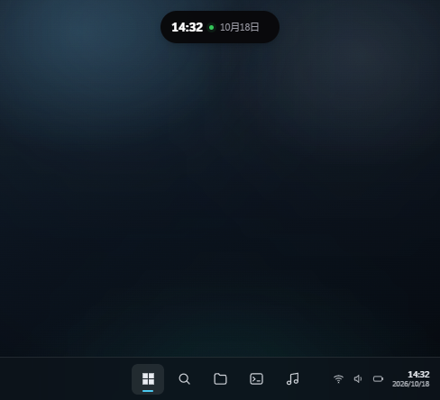
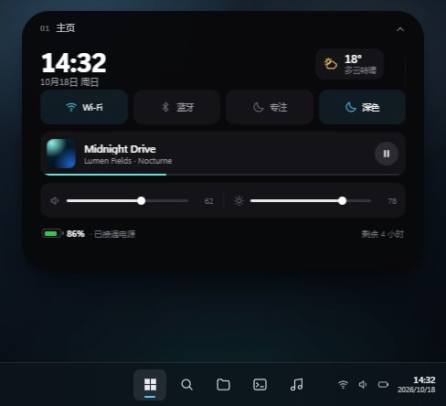

# Flutter

> Windows 桌面灵动岛与桌面控制中心

Flutter 是一个面向 Windows 的桌面灵动岛应用。它将媒体播放、系统状态、通知与常用操作汇集到屏幕顶部的胶囊和展开面板中，并支持插件扩展、主题材质设置以及 Windows 原生集成。

本项目的 Windows 可执行程序程序集名为 `flutter`，应用设置、日志等数据目录仍使用 `FluidBar` 名称。

<p align="center">
  
</p>

<p align="center">
  <a href="https://github.com/matteo-oss/WindowsIos/releases">下载 Windows 版本</a> ·
  <a href="https://fluidbar.doulor.cn">项目演示网站</a> ·
  <a href="https://github.com/matteo-oss/WindowsIos/issues">报告问题</a>
</p>

## 功能

- **桌面灵动岛**：在 Windows 桌面顶部显示紧凑胶囊，展开后浏览控制中心、媒体、通知、剪贴板、Agent 和小组件页面。
- **媒体控制**：显示受支持应用的播放状态，并提供媒体控制入口。具体可用能力取决于媒体应用及 Windows 媒体会话接口。
- **系统状态与快捷操作**：提供音量、亮度、网络、电池、蓝牙等系统信息或操作入口；部分能力受设备硬件、Windows 版本和权限影响。当前产品中仍保留 Dock 模式代码和设置项，不应将其与此前的 UI 调整混淆。
- **Windows 通知**：通过 Windows 用户通知监听接口读取通知。首次使用及系统策略可能要求在 Windows 中授权通知访问；拒绝授权时通知页无法读取系统通知。
- **剪贴板历史**：显示应用记录的剪贴板项目，并提供暂停记录、隐藏预览等设置。避免将密码、令牌等敏感内容留在剪贴板历史中。
- **任务与日历小组件**：提供任务查看和管理窗口，可新增、编辑、删除、完成任务；任务列表保存在 `%APPDATA%\FluidBar\tasks.json`。日历和天气数据是否可用取决于系统、网络和位置设置。
- **外观设置**：支持浅色/深色/跟随系统、黑曜石/亚克力/液态玻璃材质、动效、字体比例、屏幕位置及多显示器行为等设置。不同材质的实际观感取决于桌面背景与图形环境。
- **插件系统**：支持管理插件、查看权限并安装 `.fbp` 插件包。仓库包含倒计时和文件暂存可选插件；它们需要单独构建/安装，不应假定首次启动时已启用。
- **文件暂存插件**：安装并启用后可暂存拖入的文件、复制路径/文件、拖出到其他应用；插件也会监视常见的“Screenshots/屏幕截图”目录并自动收录新截图。此功能不是截图工具，不负责拍摄截图；原文件不会因暂存而被移动或删除。
- **便携式发布包**：发布脚本生成 Windows 自包含单文件程序及 ZIP。解压后运行 `flutter.exe`，无需在目标电脑上单独安装 .NET Runtime 或 SDK。

## 界面演示

以下图片是仓库中用于产品演示的静态 UI 素材，不代表当前桌面实时内容。

| 收起状态 | 展开控制中心 |
| --- | --- |
|  |  |

浅色桌面示例：


更多交互演示请访问[项目演示网站](https://fluidbar.doulor.cn)。

## 下载与运行

前往 [GitHub Releases](https://github.com/matteo-oss/WindowsIos/releases) 下载与设备架构相符的 Windows ZIP。通常的 Intel/AMD 电脑选择 `win-x64`；Windows on ARM 设备使用专门提供的 `win-arm64` 包。

1. 解压 ZIP 到一个有写入权限的位置。
2. 双击 `flutter.exe` 启动。应用可能驻留在系统托盘中；可通过托盘图标、胶囊或配置的全局快捷键访问。
3. 若 Windows 弹出通知访问授权提示，按需允许。通知访问也可在 Windows 设置中管理。

便携包包含 .NET 运行时，因此**运行应用无需安装 .NET SDK 或 Runtime**。Windows 安全策略、缺失系统组件或组织策略仍可能阻止未经签名程序运行；本项目没有声称发布包经过代码签名。

> 当前代码声明的最低 Windows 版本为 Windows 10 版本 2004（Build 19041）。新一些的 Windows 功能会在系统不支持时不可用或降级。

## 从源码构建

### 环境要求

- Windows 10 版本 2004（Build 19041）或更新版本；
- .NET SDK `10.0.301` 或支持 `global.json` 中 `latestFeature` 滚动策略的 .NET 10 SDK；
- Git；
- 首次还原 NuGet 依赖时需要网络连接。

克隆仓库并构建：

```powershell
git clone https://github.com/matteo-oss/WindowsIos.git
cd WindowsIos
dotnet restore FluidBar.sln
dotnet build FluidBar.sln -c Release
```

运行桌面应用：

```powershell
dotnet run --project src/FluidBar.App/FluidBar.App.csproj
```

运行解决方案测试：

```powershell
dotnet test FluidBar.sln -c Release
```

### 生成便携 ZIP

在 Windows 仓库根目录双击 `tools\release\package.cmd`，或在 PowerShell 中运行：

```powershell
powershell -NoProfile -ExecutionPolicy Bypass -File tools/release/publish.ps1
```

默认目标为 `win-x64`。也可在安装了相应 .NET 10 SDK 的 Windows ARM64 构建环境中生成 ARM64 包：

```powershell
powershell -NoProfile -ExecutionPolicy Bypass -File tools/release/publish.ps1 -Runtime win-arm64
```

输出目录与压缩包：

```text
build/release/
  win-x64/flutter.exe
  flutter-4.1.0-win-x64-portable.zip
```

脚本以 `Release` 配置发布，启用 `SelfContained`、`PublishSingleFile`，并在输出目录写入包含运行时标记和 SHA-256 的 `publish.json`。`-SkipZip` 可仅发布目录而不创建 ZIP。每次发布前脚本会重建对应的 `build/release/<架构>` 输出目录；不要把个人文件存放在该目录中。

## 可选插件

仓库中的可选插件不会因为存在于源码仓库就自动出现在用户安装中。先构建、打包，再从应用设置中的插件安装入口选择 `.fbp` 文件。

**倒计时插件**

```powershell
dotnet build plugins/fluidbar-timer -c Release
dotnet run --project src/FluidBar.Cli -- pack --plugin plugins/fluidbar-timer --configuration Release --out build/plugins/fluidbar-timer-1.0.0.fbp
```

**文件暂存插件**

```powershell
dotnet build plugins/fluidbar-file-shelf -c Release
dotnet run --project src/FluidBar.Cli -- pack --plugin plugins/fluidbar-file-shelf --configuration Release --out build/plugins/fluidbar-file-shelf-1.0.3.fbp
```

关于暂存容量、截图目录、拖放和权限行为，请参阅各插件自己的说明：[倒计时插件](plugins/fluidbar-timer/README.md)、[文件暂存插件](plugins/fluidbar-file-shelf/README.md)。只安装信任的插件；插件会以当前用户权限运行。

## 配置与数据

- 应用设置：`%APPDATA%\FluidBar\settings.ui.json`；
- 任务列表：`%APPDATA%\FluidBar\tasks.json`；
- 日志：`%LOCALAPPDATA%\FluidBar\logs`；
- 剪贴板及插件数据按对应功能和插件的存储策略保存于本机应用数据目录。

默认设置启用匿名使用数据选项。代码定义的遥测负载包含随机匿名安装 ID、应用/系统环境（包括 Windows 版本、处理器架构和界面语言）、会话时长、首帧启动耗时、首次运行标志和退出原因等字段，不包含通知正文、剪贴板文本或文件路径；可在应用设置中关闭遥测。关闭后会丢弃本地待发送队列。具体实现与字段变更以源码为准。网络功能（例如更新检查、插件市场、天气和遥测）需要网络连接；网络不可用时相应在线能力会受限。

## 项目结构

```text
src/
  FluidBar.App/              Windows 桌面应用、界面与应用组合
  FluidBar.Core/             核心模型、布局与配置
  FluidBar.Island/           灵动岛绘制和页面组件
  FluidBar.Platform.Windows/ Windows 平台集成
  FluidBar.Plugins.Builtin/  内置插件
  FluidBar.PluginHost/       插件加载与运行
  FluidBar.Sdk/              插件 SDK 与契约
  FluidBar.Marketplace/      插件市场与签名模型
plugins/                     可选插件及示例
tests/                       自动化测试项目
tools/release/               Windows 自包含发布及 ZIP 脚本
website/                     演示网站
```

## 问题反馈与贡献

使用 [GitHub Issues](https://github.com/matteo-oss/WindowsIos/issues) 报告缺陷或提出建议。请尽量提供 Windows 版本、处理器架构、应用版本、复现步骤和相关日志；提交前删除通知内容、个人路径等敏感信息。代码改动建议先运行相关测试，并说明验证过的系统环境。

## 许可证

本项目以 [MIT License](LICENSE) 授权。第三方依赖和网站字体/组件可能分别适用其自身许可证，请同时遵守相应许可文件。
